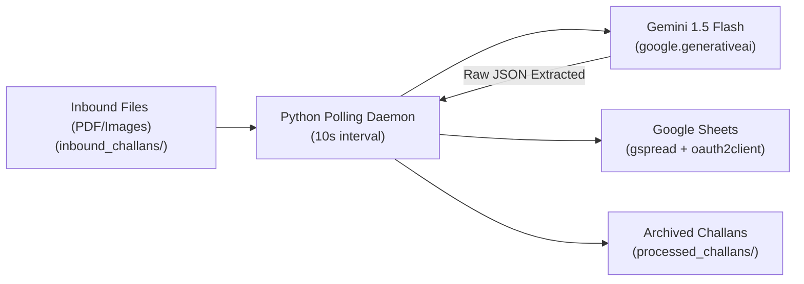

# Micro-WMS Inbound Logistics Pipeline

An automated, intelligent document extraction pipeline for warehouse inbound logistics. It continuously monitors an `inbound_challans` folder, extracts structured challan data from PDF and image files using **Google Gemini 1.5 Flash**, records the records into **Google Sheets**, and archives processed files to prevent duplicate entries.

## System Architecture



## Extracted Fields

The model extracts the following 5 parameters as raw, valid JSON:
* `Date`: Date on the delivery challan
* `Challan_No`: Delivery Challan or Invoice reference number
* `Client_Name`: Name of the client / vendor / consignee
* `Vehicle_No`: Vehicle registration or carrier identifier
* `Inward_Qty`: Total inward / received quantity

## Prerequisites

1. **Python 3.9+**
2. **Gemini API Key**:
   - Generate a key at [Google AI Studio](https://aistudio.google.com/).
3. **Google Cloud Service Account**:
   - Enable **Google Sheets API** and **Google Drive API** in Google Cloud Console.
   - Create a Service Account and download its key as a JSON file.
   - Save this file locally in the project root as `service_account.json` (this file is excluded in `.gitignore` for security).
   - Create a Google Sheet (e.g. named `Inbound Challans`) and **share it with Editor permissions** to the `client_email` address listed in `service_account.json`.

## Quickstart Setup

1. **Clone the repository:**
   ```bash
   git clone https://github.com/keshavnayan1726-cloud/warehouse-automation.git
   cd warehouse-automation
   ```

2. **Create and activate a virtual environment:**
   ```bash
   # Windows (PowerShell)
   python -m venv venv
   .\venv\Scripts\Activate.ps1

   # Linux/macOS
   python3 -m venv venv
   source venv/bin/activate
   ```

3. **Install dependencies:**
   ```bash
   pip install -r requirements.txt
   ```

4. **Configure environment variables:**
   Copy `.env.example` to `.env`:
   ```bash
   cp .env.example .env
   ```
   Edit `.env` and set:
   ```env
   GEMINI_API_KEY=your_actual_gemini_api_key
   SPREADSHEET_NAME=Inbound Challans
   SERVICE_ACCOUNT_FILE=service_account.json
   ```

5. **Run the pipeline:**
   ```bash
   python inbound_pipeline.py
   ```

6. **Test with a Challan:**
   Drop any PDF or image challan file into `inbound_challans/`. Within 10 seconds, the script detects the file, extracts the fields using Gemini 1.5 Flash, appends a new row to Google Sheets, and moves the document to `processed_challans/`.
